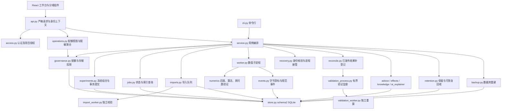

# v0.4.0 架构与权限边界

本文面向维护者与验收者，记录当前实际模块、事务与进程边界。功能逐项登记见 [prd-acceptance.md](prd-acceptance.md) 和 [feature-coverage.json](feature-coverage.json)；[system-architecture.md](system-architecture.md) 保留 v0.2/v0.3 历史依据。本版仍为单机 CPU 工作台：一个数值队列运行器、一个独立导入运行器，不声称多节点调度或通用操作系统沙箱。

## 模块职责与依赖

| 模块 | 实际职责 | 关键边界 |
|---|---|---|
| `contracts.py` | 严格版本化配置，类型/范围/冲突与未知字段校验 | UI、CLI、API最终共用解析结果；方法切换不改目标与硬预算 |
| `api.py` / `access.py` | HTTP适配、严格请求、令牌身份、项目角色、授权拒绝审计 | API不直接执行数值算法；错误不返回路径或自由格式堆栈 |
| `service.py` | 组织项目、资产、计划、队列、报告、备份和恢复 | 保留兼容入口；调用领域模块，不把HTTP规则放入数值核心 |
| `store.py` / `jobs.py` / `events.py` | 事务、查询投影、状态转换、稳定分页及规范事件 | SQLite为元数据与规范事件的事实来源；JSONL是按需导出快照 |
| `governance.py` / `operations.py` | 严格配额、项目逻辑用量、排队容量、无业务字段的运维视图 | 运维角色不会因此成为项目成员；配额读写与业务下载授权分开 |
| `imports.py` / `import_worker.py` | 流式接收后的持久导入队列、独立读取/检查、取消与最终登记 | 登记时重新检查原提交身份；不伪造校验百分比或复活已取消导入 |
| `numerics/backend.py` | `prepare/solve/monitor/finalize`协议、实际算法计划、资源分项和坐标恢复 | 支持ARPACK、块反演、JD；结构对角快捷路径另记实际方法 |
| `block.py` / `correction.py` / `shift_policy.py` | 块迭代、投影JD修正、受限位移反馈及精度控制 | JD的32位近似修正须经原64位修正方程复验，失败提升64位；最终原问题独立验证不放宽 |
| `checkpoint.py` / `resumption.py` | 输入/配置/版本/子空间快照校验，新任务热启动 | `exact_resume=false`，不序列化或宣称ARPACK精确续算 |
| `recovery.py` / `reconcile.py` / `validation_process.py` | 核验存活进程、补登记已发布结果、另起有界原问题验证 | 不凭PID发信号；不信任缓存的`PASSED/CERTIFIED`或重算过的文件哈希 |
| `advice.py` / `knowledge.py` / `ai_explainer.py` / `effects.py` | 受保护建议、出处、可失败本地解释、派生配置与追加效果台账 | 建议/AI不改输入、目标、验收、资源或数值终态；GET预览不追加效果记录 |
| `retention.py` / `backup.py` | 可恢复回收、完整快照、严格恢复与显式缺文件降级 | 只回收到期且显式不保留的结果；元数据和依赖链受保护；恢复只进新空根 |
| `reporting.py` / `public_export.py` / `protocols.py` | 逐次/批次报告、公开包脱敏扫描、冻结基准和适用消融 | 所有失败/超时/阻断保留分母；没有参考就明确未认证，不展示虚假加速比 |

## schema2与资源投影

数据库`PRAGMA user_version=2`。实体表固定为`seq,kind,id,body,status,project_id`，`UNIQUE(kind,id)`；`body`保存完整记录，`status/project_id`在同一次UPSERT中提取，`seq`更新时不变。索引覆盖类型、状态、项目与入库顺序。新增`imports`、`project_storage`、`advice_effects`、`experiment_plans`等是实体种类，**没有为每种领域对象新增SQL表或更改schema版本**。

规范事件独立存于`events(job_id,seq,body)`；审计存于`audit(seq,body)`；幂等摘要位于`idempotency`；`store_meta`保存实例身份。游标绑定实例、过滤条件和首次入库上界，恢复实例重新生成身份，旧实例的游标不能跨库复用。迁移和恢复分批重建已知结构，不安装归档中的触发器、视图或索引。

`project_storage`按项目累计逻辑输入/输出字节：输入同项目按哈希去重，资产登记、任务结算和回收与投影更新共用事务。历史缺少投影时先获得写事务，再做一次核对；它不是每次轮询都扫描完整目录。预约输出来自活跃任务冻结的`disk_limit_gib`之和，实际字节与预约量分别显示。跨项目去重的物理磁盘占用与项目逻辑计费不同，不能把项目用量相加后冒充物理盘占用。

数值调度按项目优先级、同优先级入库顺序选择一个任务。提交前检查项目存储/排队配额及全局有界队列，组合实验整体事务预检和提交。内存估计包含输入副本、CSR/CSC、重排、向量块、候选/验证、GMRES工作区、混合精度矩阵、预条件和日志；LU填充区间是风险场景，不是保证上界。运行监督仍按整个工作进程树的实际内存、时间和输出字节限制回收；数值导出再次检查真实磁盘占用，未通过不发布成功清单。

## 业务身份与运维角色

原PRD第3章要求系统管理员“默认不具备业务数据下载权限”。v0.4以独立`operations_admin`实现该默认；原`global_admin`明确解释为额外授予业务访问和完整备份权限的**工作台所有者**，不将它冒称默认受限的系统运维角色。

| 身份/角色 | 权限来源 | 默认业务读取/下载 | 运维与备份 |
|---|---|---|---|
| `viewer` | 显式项目成员 | 仅已授权项目的历史、结果与下载 | 无跨项目配额管理，无完整备份 |
| `analyst` | 显式项目成员 | 同上，并可导入/运行 | 不可改成员或公开授权；无完整备份 |
| 项目`admin` | 显式项目成员 | 已授权项目管理和业务访问 | 可设本项目成员/策略/保留；无全库备份 |
| `operations_admin=true` | 服务端独立令牌身份配置；缺省严格为`false` | **无默认项目读取或下载**；另获成员授权才按该项目角色生效 | 脱敏聚合、仅项目编号/配额/用量的分页视图及策略更新；无业务备份文件下载 |
| `global_admin=true` | 服务端显式授予的所有者身份 | 显式拥有业务访问 | 可读取完整备份、恢复、全局维护，也可使用运维视图 |
| 本地/共享令牌所有者 | 明确的离线单用户模式 | 本地数据归该用户；不是多人隔离模型 | 本地所有者权限保持兼容；多人部署须启用独立身份配置 |

身份配置只接受已知字段和真实布尔值，必须保留一个显式所有者以避免锁死。`operations_admin`附加在身份结构末位，旧身份文件不写该字段时保持旧行为。运维角色既不能自建业务项目获得自授成员资格，也不能通过配额端点改项目名称、成员或数据公开声明。显式成员授权后可读相应项目，仍不能下载整个工作台私有备份。

| 运维接口 | 返回/允许修改 | 不返回的内容 |
|---|---|---|
| `GET /operations/summary` | 索引聚合数量、固定状态分布、安全健康字段、最近最多1000条审计的操作/结果计数 | 主体、对象标识、审计原文、矩阵/结果数值、项目名称 |
| `GET /operations/project-policies` | 分页`items,next_cursor,total`；每项仅`project_id,policy,usage` | 项目名称/说明/分级/成员、输入指纹、业务结果 |
| `PATCH /operations/project-policies` | 只接受`project_id,policy`，严格验证四项配额策略并留审计 | 不授予项目角色，不返回完整项目记录 |

这些接口只向运维角色或显式所有者开放。`/metrics`仍限所有者；运维监控使用上述安全聚合接口。设置页只展示相应角色的运维控件，并禁止非所有者的备份/恢复/清理操作。服务端授权仍是最终边界，界面隐藏或禁用不替代授权检查。

**保留的需求边界：**账号签发/撤销由服务端身份文件管理，没有自助账号生命周期产品；仅管理本机运行器，不提供多工作节点控制；运维账号不提供独立备份调度或私有备份下载入口，由显式所有者执行受保护备份。权限粒度是项目，不提供同项目内逐文件或逐任务所有者ACL（单独的访问控制表）；需要进一步人员隔离时应分项目。这些限制不能在材料中改写为企业账号系统、多节点运维或逐文件隔离已实现。

## 导入、运行与验证数据流

1. API先确认项目写权限和文件名/元数据，按块接收上传，超过预算或断开则回收暂存文件；`POST /imports`只把已接收文件交给导入队列。
2. 导入子进程在读取前后核对冻结哈希，以安全数值读取和有界诊断返回结果。父进程校验结果JSON/大小/形状，再在原提交身份与同一事务下登记；取消与登记争同一边界，不可能两边同时成功。
3. 配置、计划和输入哈希冻结后提交任务。父进程启动去凭据环境的数值子进程，接收白名单事件；数值后端在原始坐标恢复候选后，独立重算原问题残差/正交性及有依据的目标认证。
4. 服务原子追加规范事件与字节游标，再推进权威终态。原始规范事件先落库，次要观测进入有界非阻塞队列；导出器失效或饱和只增加丢弃计数，不阻塞求解或改数值状态。
5. UI按序补取并只留最新1000事件。块/JD的逐候选位置残差保留桶极值与首末值，失败/位移/锁定/停滞/重启/回退标记独立保留；位置不是固定物理模式身份。ARPACK没有逐外层历史时明确不可用，完整规范JSONL可下载。

导入默认为1GiB输入、120秒、2GiB进程树常驻内存及1MiB结果上限；数值作业使用自身冻结预算。导入和数值运行器可能同时工作，**不宣称二者预算相加经过一个统一集群资源池分配**。导入重启只恢复可安全继续的排队输入；原运行导入统一标记`WORKER_LOST`，与数值进程接管能力不同。

## 重启接管与已发布结果补登记

`recovery.py`校验PID出生时间、命令参数、当前解释器、模块来源、属主/权限、无符号链接的控制路径、只读原输入和规范化完整spec。身份无法证明时不接管、不据PID误发信号。实际macOS存活子进程跨旧服务退出的证据见 [live-worker-reattachment.json](evidence/live-worker-reattachment.json)。翻译Linux中解释器显示为Rosetta且无法证明同一文件时安全拒绝；[平台记录](evidence/v040-recovery-platform.json)明确这不证明Linux原生接管成功。

若工作进程已退出但存在完整发布清单，`reconcile.py`先核对原输入、冻结配置及全部允许产物哈希，再调用`validation_process.verify_bounded`。它另启`validation_worker`从原矩阵及候选数组重新计算，不信任缓存`validation.json`或攻击者同时重写的清单哈希。验证进程有时间/内存/控制文件大小上限、最小环境和严格结果JSON校验；超限、损坏或不确定即拒绝恢复成功。接管缺测期间的峰值只作为下界，并显式记录观测缺口。

工作事件读取器在事务失败时回退字节游标，避免数据库回滚后静默丢事件；终态之前再次排空工作文件。检查点则是另一条路径：兼容性校验后作为**新任务初始子空间**，不能与运行进程接管或已发布结果补登记混称精确续算。

## 建议效果与原子回收/备份

`effects.py`为`derived/linked/observed`分别追加新ID记录，冻结前后完整配置与受保护条件。派生不覆盖原任务，关联新任务必须匹配输入与派生配置；`GET /advice/effects/{id}`只预览，显式有写权限的`POST .../evaluate`才记录，观测摘要相同不重复追加。硬件、资源、输入/目标/验收或认证条件不满足时不计算加速比。

结果默认保留；只有`retained=false`且终态、过期、无活动或被保留后代依赖时，才移动允许的数值结果到私有隔离区。数据库提交后再物理清除，失败留下`cleanup_pending`；崩溃时按私有日志恢复或完成删除。配置、清单、规范事件及未知文件不会随结果回收静默消失。

备份持有跨Store的SQLite即时写事务，拒绝活动求解/导入，先处理未完成回收，再从独立只读连接取得SQLite快照并流式打包。严格恢复检查归档哈希、数据库引用和已发布清单载荷，即使缺文件未列在备份清单中也要拒绝；只有显式`allow_missing`允许降级。新实例重建索引、配额与游标身份，缺失输入不可运行，待导入私有身份被剥离。

## 当前验证与平台边界

- 运维权限的真实API正反例位于 [test_operations_access.py](../tests/test_operations_access.py)，包括严格身份、默认业务拒绝、显式成员允许、配额写入和审计；前端54项模型测试与生产构建通过。
- 当前0.4.0冷安装及服务闭环见 [macOS安装](evidence/v040-macos-installation.json)、[macOS独立实例](evidence/v040-macos-offline-instance.json)、[Linux独立实例](evidence/v040-linux-offline-instance.json)。每次实际完成服务、构建资源、求解、独立原问题验证、公开包校验、备份恢复和新任务复跑；服务进程已回收。
- macOS安装使用`--no-index`本地wheel，运行只请求回环地址；该宿主没有关闭操作系统网络。Linux镜像实际为`network=none`、只读根、去能力和2GiB限制，运行于macOS arm64上的Linux amd64翻译环境，证明功能隔离，不证明原生赛事性能。
- [参考隔离实测](evidence/v040-linux-isolation.json)记录求解容器仅挂载输入/配置/输出、参考与容器套接字访问被拒绝、网络错误101；独立评测在候选退出后进行。普通Web/CLI工作进程只具有进程与环境边界，不能据此宣称操作系统文件访问沙箱成立。
- NIST MHD1280B真实来源样例的原问题残差检查不等于最近目标完整性认证；它不是微波器件验收数据，许可UNKNOWN，输入不进入公开包。没有原生赛事硬件、官方参考或公开授权时，相关结论继续受条件限制。

术语：Ritz候选是从当前搜索子空间得到的近似模式；JD为Jacobi–Davidson投影修正算法；GMRES为修正方程使用的迭代线性求解法；schema2指本项目SQLite结构版本2；投影指随实体同步维护的少量查询/用量字段；隔离区是提交前可撤回的文件暂存目录，不是容器安全沙箱。
