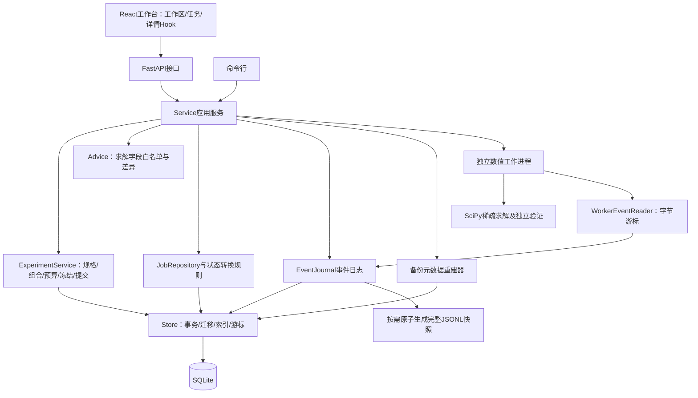

# EMSolver v0.3.0 数据结构与系统架构

> 本文保留v0.2/v0.3历史范围与证据。当前v0.4.0模块、独立运维权限、进程接管、导入、效果台账和一致备份说明见 [architecture-completion.md](architecture-completion.md)，不要将下文旧限制直接当作当前能力。

适用范围：本地CPU工作台、单个数值工作进程。v0.3增加参数实验领域模块、建议保护和摘要分页；v0.2的查询、状态、事件及恢复边界继续保留。数值算法和最终验收口径保持原状。

术语：JSON是用文本保存结构化字段的格式；schema指数据库结构版本；Hook是封装界面请求和状态的React函数；UPSERT表示不存在则新增、存在则更新的一次原子写入；FIFO表示先进先出；游标是定位已读位置的翻页标记。

## 组件与依赖

`Service`保留兼容入口，负责组织用例。状态规则与作业查询位于`emsolver/jobs.py`，事件读取及导出位于`events.py`，恢复数据库验证与分批重建位于`backup.py`；它们不依赖HTTP。`Store`处理持久化细节。共享错误与流式文件哈希分别位于`errors.py`和`integrity.py`。

`experiments.py`集中处理严格实验规格、组合展开、预算、冻结完整性、原子提交及分组统计，通过`ExperimentGateway`协议调用既有资产与任务用例，不导入API或`Service`具体类型。`advice.py`是保护输入、目标、验收及资源限制的纯校验模块。前端实验区拆成独立组件与类型模型，不继续扩大App中的基准表单。

## 实验数据与事务

新增`experiment_plans`实体保存规范化规格、预算、每组求解计划与配置快照、字段差异和内容哈希。`benchmarks`继续保存提交批次，增加实验计划引用及冻结哈希；旧基准记录和接口保持兼容。任务首次入库即保存`experiment={batch_id,cell_id,repeat}`，不由运行顺序推断归属。没有修改schema2的表结构。

冻结前先约束各轴长度并去重，限制组合与总运行数量，再按时间/磁盘硬限额之和检查总预算。所有组合的配置、求解计划和实验计划共同提交；中途预检或审计失败整批回滚。冻结不是提交，不生成任务。

提交统一遵循`应用互斥锁 → SQLite即时写事务`顺序；批次ID由实验计划ID确定。同一方案网络重试返回原批次。首次提交检查计划及配置引用完整性，重新检查输入文件、运行能力、归档状态和100个排队任务的全局容量，随后所有任务、事件、幂等键、批次及审计一起提交。跨连接提交依靠SQLite写事务串行化，进程内锁不被视为跨进程锁。

`summary`保留旧全部已记录耗时统计，额外提供认证成功耗时及其分母。`groups`按冻结组合返回全部任务归属、参数、逐字段差异、成功/部分/失败/终态数量。总数包括未结束任务；目标或资源不同的组不自动输出加速比。总预算是本批次配置上限总和，不是实际耗时预测，也不包含保留的历史磁盘用量。

采用规则建议由后端按完整字段路径白名单校验。禁止更改输入、目标、验收和全部资源字段；允许的求解字段仍经共享配置协议验证。生成新配置，保存原配置哈希、可选来源任务及逐字段差异，不修改原任务。

## 实体与查询投影

实体仍使用JSON正文保存完整版本化记录。数据库同时存储少量查询字段，避免为查队首读取全部配置和结果：

| 字段 | 用途 | 一致性规则 |
|---|---|---|
| `seq` | 稳定递增的入库顺序 | 更新实体时不改变；不使用随机ID或时间戳代替FIFO |
| `kind,id` | 实体类型与业务标识 | 组合唯一 |
| `body` | 完整实体正文 | 事实来源；返回解码副本 |
| `status` | 状态筛选、队列计数 | 从正文提取，与正文同一次UPSERT更新 |
| `project_id` | 项目范围筛选 | 同上；非字符串投影为NULL |

索引覆盖`kind+seq`、`kind+status+seq`、`kind+project_id+seq`、`kind+project_id+status+seq`。队首只读取一条正文，队列计数只扫描匹配索引；工作区汇总在同一读事务中完成。精确总数仍有索引扫描成本，不宣称所有查询恒定时间。

schema2迁移使用一个写事务重建实体表，分批复制旧正文字符串并保留`rowid→seq`对应关系，最后提交版本。版本检测在取得写锁后重新执行；表替换失败会回滚。未知未来版本、异常旧表结构和非正旧rowid安全拒绝。事务迁移后再切换WAL（预写日志，用日志协调读写）模式，并对模式切换的临时锁冲突有限重试。

## 分页与状态

新接口：

| 接口 | 返回与边界 |
|---|---|
| `GET /api/v1/jobs/page` | `items,next_cursor,total`；每页1至200条，默认50；可筛项目、合法任务状态 |
| `GET /api/v1/jobs/{id}/events/page` | `items,next_after,has_more`；每页1至1000条，默认200 |
| `GET /api/v1/workspace/summary` | 数据库聚合总量、活跃量、认证量、状态分布 |
| `GET /api/v1/benchmarks/page` | 项目筛选、稳定游标；默认20，最多200；不展开runs和cells |
| `POST /api/v1/experiments/plans` | 有界组合预检并冻结方案；不入队 |
| `POST /api/v1/experiments/submit` | 同一方案幂等、整批事务提交 |
| `POST /api/v1/benchmarks/{id}/cancel` | 取消未结束任务，终态保持原值 |
| `POST /api/v1/configs/advice` | 服务器保护字段，返回新配置与差异 |

任务游标使用稳定序号，绑定数据库实例及筛选条件，并冻结首次请求时的入库上界。新增任务不会把旧翻页过程推移；不同筛选、不同恢复实例、非法数值或字段均拒绝。实体的状态仍是请求时的当前值，不承诺多个HTTP请求之间持有数据库事务快照。旧无参列表及事件接口继续兼容，仍可能全量读取；新工作台和内部调度已不使用它们轮询。

任务状态由集中转换规则限制：排队只能进入运行、失败或取消；运行/验证可进入终态；取消中不能转成功；终态不可重开。重复取消保持幂等。重试创建新任务，父任务关联首次入库时即保存。

## 事件一致性与内存边界

SQLite是事件的唯一事实来源。任务状态、事件和审计在数据库事务中一起提交或回滚，不再同步写入一个无法回滚的JSONL副本。完整事件文件通过授权下载按需生成：冻结最高seq，以500条一批读取，唯一临时文件写完后原子替换。

worker文件是进程间事件输入：读取器保存字节偏移，只消费完整换行；半行下次继续，非法JSON跳过，按字段白名单导入。检测到进程退出后再次补读，再写终态事件，消除最后一批事件被遗漏的窗口。

前端按seq去重、排序并保留最近1000条；一次轮询最多追赶5页，积压继续短间隔读取。先读取任务状态，再读取事件，排空终态事件并成功处理结果后停止详情轮询。切换任务使用AbortController（中止旧网络请求），旧响应不能串入新任务。空闲任务列表降低轮询频率；详情停止不等同于工作区汇总永远不再刷新。

任务列表按入库升序加载。定时刷新首页；后续已加载页保留加载时的实体快照，选中详情会独立获取当前值。手动刷新开启新分页快照。批次工作区按页读取摘要，只在选中时读取完整详情，活跃详情轮询至终态；初次工作区加载不再读取全部批次和运行。项目与矩阵目录仍保留完整列表，是后续规模扩大的边界。摘要页计算每批最多100个任务，仍有与页内批次数及组数相关的读取成本。

## 恢复与回退

恢复在新的空数据目录执行。只读不可变源数据库与目标数据库使用不同文件；从原入库顺序分批读取，每批最多500行，关联通过源库查询校验；全部目标写入处于同一事务。事件序号与事件正文不匹配、非法引用或损坏文件均拒绝。索引、查询投影和实例ID由已知代码重建，不安装归档中的触发器、视图或索引。

v0.3恢复白名单增加实验计划，检查方案内容哈希、组合的计划/配置/矩阵对应关系及任务的批次和组合归属。旧备份继续支持。v0.2恢复器会拒绝含新实体的备份，因此包含实验的恢复必须使用v0.3或更新版本；本次迭代前内部快照保留在`artifacts/experiment-baseline/`。

本次真实迁移前备份保存在`artifacts/architecture-baseline/pre-migration.sqlite3`，相应旧源码在同目录`source.zip`；这些是内部回退材料，不进入公开源码包。输入矩阵与既有产物未删除。**schema2不能交给旧版三列裸INSERT程序直接写入。** 回退时先停止v0.2服务、保留当前数据副本，再恢复对应旧源码与迁移前SQLite文件，使用原数据根目录；不能在服务运行时直接替换数据库文件。

## 验证与限制

- v0.3后端完整测试268项通过；前端模型测试30项通过，生产构建通过。覆盖组合/预算、配置重放、完整性、跨连接容量、回滚、备份恢复和建议保护。
- 本机浏览器4组×2次真实运行共8次全部认证成功；另一取消演示保留5次完成和15次取消记录。重复提交未增加任务，修改参数撤销旧预览，终态后不再追加详情请求。
- 迭代前28条实体正文与84条事件逐条保留一致。新独立环境使用`--no-index`安装v0.3 wheel，4组真实运行全部通过读回验证，并验证备份恢复后的幂等批次归属。环境限于macOS arm64/Python3.12，不表示Linux实机或物理断网已验收。
- 本轮证据：`evidence/experiment-runtime-verification.json`、`experiment-offline-verification.json`、`experiment-tests.log`、`experiment-web-tests.log`、`experiment-build.log`及`experiment-review.md`。

以下为v0.2历史架构验证，保留原条件，不替代本轮结果：

- v0.2后端183项和前端12项测试通过。
- 真实库24条实体的正文字符串及顺序完全一致，71条事件保留；详见`evidence/production-migration.json`。
- 2万条合成历史任务、7次本机测量中位数：旧全量查队首48.8135ms，新索引查队首0.0095ms；仅为本机查询诊断，详见存储报告，不作为工业求解加速承诺。
- 浏览器验证了真实新任务成功、独立53条任务分页，以及终态后32秒无详情追加请求。独立安装的v0.2包也通过十万阶合成输入求解与读回校验。
- 仍为本地单用户/共享令牌模型；多用户权限、精确续算、GPU/MPI/SLEPc和完整PRD验收的未完成范围不因本次重构而改变。

证据：`evidence/store-optimization-report.md`、`event-optimization-report.md`、`frontend-architecture-report.md`、`architecture-review.md`及`architecture-verification.json`。
