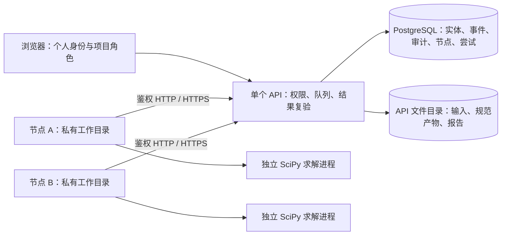

# 多人协作与多节点计算：架构、部署与迁移

本文面向部署维护人员与项目管理员，描述当前源码已实现的多人访问、PostgreSQL 元数据存储和远程计算节点。命令均从仓库根目录执行；`python` 指已安装本项目及相应可选依赖的解释器，原生部署示例使用独立虚拟环境。凭据通过受保护文件或环境变量提供，本文不包含凭据值或数据库连接串。

**当前交付形态是一个 API（应用程序接口，统一接收浏览器和节点请求的服务）、一个 PostgreSQL 数据空间，以及按任务领取工作的独立计算节点。每个任务在一台节点上运行，每个节点同时处理一个任务；没有把同一矩阵拆到多台机器共同求解。**

## 1. 实现范围与部署边界

| 项目 | 当前实现 |
| --- | --- |
| 多人协作 | 每个用户使用独立 Bearer 令牌（请求携带的身份凭证），结合项目成员角色控制访问 |
| 元数据 | 默认保留 SQLite；显式配置 `EMSOLVER_DATABASE_URL` 后使用 PostgreSQL |
| 执行模式 | `EMSOLVER_EXECUTION_MODE=local` 使用本机队列；`cluster` 使用持久化远程节点队列 |
| 多节点 | 节点通过 HTTP 下载输入并上传结果，无需挂载 API 的业务数据目录 |
| 数值后端 | 远程节点当前仅支持 SciPy、CPU、单任务单节点；不支持远程 SLEPc、GPU 或多节点联合求解 |
| 权威结果 | API 使用原输入与冻结配置重新验证，远程节点声称“成功”不能直接成为任务成功状态 |
| 文件存储 | 输入、产物、报告和暂存文件仍位于 API 的本地数据根目录 |
| API 扩容 | 当前参考部署只启动一个 API；多个 API 副本必须共享一致的业务文件存储与身份配置，并另做完整验收 |
| 对象存储 | **尚未实现 S3 或其他对象存储适配器；不能只共享 PostgreSQL 就宣称 API 已无状态化** |
| 验收范围 | 已完成真实 PostgreSQL、回环 HTTP 和本机两个独立节点进程的闭环；不是多台物理机器或远程 HTTPS 的部署验收 |

当前主机为 macOS，原生网络证据的平台字段为 `Darwin`。另已在同一主机的 Docker Desktop 内验证 Linux ARM64 的非 root API、独立节点和 PostgreSQL 完整计算链路；外部目标 Linux 服务器仍需单独验收。

## 2. 架构与请求流



一次计算按以下顺序完成：

1. 项目成员创建计划并提交任务。配置、输入哈希和执行源码指纹随任务冻结。
2. 已登记节点报告线程、内存、磁盘、后端和执行指纹。协调器在数据库事务内选择符合项目范围与资源预算的排队任务。
3. 节点取得租约（限时执行权），通过携带租约凭证的 HTTP 请求下载输入并核对哈希。业务输入与结果只通过接口传输。
4. 节点在自己的工作目录创建独立求解进程，监控进程树内存、时限和目录用量；凭据由节点控制进程持有，不交给数值子进程。
5. API 对结果包执行大小、成员、路径、输入和配置检查，再使用独立验证进程检查原问题。验证期间不长期占用元数据写事务。
6. 只有仍持有有效租约的尝试可以发布终态与规范产物；发布失败时执行文件回滚和数据库回滚。

节点目录不需要与 API 共享，但这不等于操作系统沙箱。拥有同机文件权限的人仍可能访问其他目录；参考节点容器只挂载节点凭据和该节点工作目录，不挂载 API 数据目录、数据库凭据或 Docker 控制接口。

## 3. 数据结构与 PostgreSQL 兼容边界

| 表 | 保存内容与约束 |
| --- | --- |
| `entities` | 保留原有 `kind`、`id`、JSON 文本 `body`，另有单调 `seq` 和 `status`、`project_id` 查询投影；`kind,id` 唯一 |
| `events` | 按 `job_id,seq` 唯一的规范事件，支持连续重放 |
| `audit` | 主体、动作、对象和结果；不保存原始凭据 |
| `idempotency` | 请求键、请求摘要和任务编号，避免相同提交重试产生重复任务 |
| `store_meta` | 实例身份等元数据；分页游标绑定实例身份 |
| `cluster_workers` | 节点名称、项目允许列表、预算、后端、凭据摘要、撤销时间和最近响应 |
| `cluster_job_attempts` | 任务、节点、递增尝试号、租约摘要、期限、状态、完成摘要与受限指标；关联节点和任务实体 |
| `emsolver_schema` | PostgreSQL 存储版本，独立于 SQLite 的版本号 |

**这次 PostgreSQL 接入保留了旧版 JSON 实体模型，并没有把业务实体改造成完整的关系模型或 JSONB 模型。** `body` 仍为文本，以保留原始序列化字节并支持迁移、备份与既有查询。

旧服务中的“读取记录、修改、写回”由数据库/数据空间级的事务咨询锁（`pg_advisory_xact_lock`，由应用共同遵守的事务互斥锁）保护。不同 API 连接、进程和机器上的外层写事务因此串行执行，快照读事务可以继续读取一致数据。这解决跨连接丢更新与重复领取问题，但**不代表业务写入可以无限水平扩展**。长时间计算、网络传输和结果复验应留在写事务之外。

兼容层只覆盖项目实际使用的 `?` 参数占位符和有限 `json_extract` 查询。它不是通用 SQLite SQL 模拟器；新增 SQL 必须同时验证两种数据库。连接按线程创建，新线程建立连接前会回收已退出线程的遗留会话，防止请求线程轮换耗尽数据库连接；仍存活线程的连接及事务保持隔离。不能把已建立的连接跨进程继承；闲置断连可以重连，发生失败的写操作不会被透明重放。

源码依据：[存储选择](../emsolver/persistence.py)、[PostgreSQL 适配器与迁移](../emsolver/postgres_store.py)、[租约协调器](../emsolver/cluster.py)。

## 4. 用户、项目角色与节点凭据

| 身份或凭据 | 权限范围 | 配置或保存方式 |
| --- | --- | --- |
| 工作台所有者 | 全局管理、节点登记与撤销、备份和维护；可访问所有项目 | `EMSOLVER_IDENTITIES_FILE` 中的 `global_admin=true` |
| 项目 `admin` | 当前项目的成员、策略与业务管理 | 项目的 `members` 列表 |
| 项目 `analyst` | 当前项目导入、配置与计算 | 项目的 `members` 列表 |
| 项目 `viewer` | 当前项目的读取和获准下载，不能提交计算或管理节点 | 项目的 `members` 列表 |
| `operations_admin` | 聚合运维与配额维护；自身不授予项目业务读取、节点管理或完整备份权限 | 身份文件中的显式标记 |
| 节点凭据 | 仅允许节点协议操作，受项目允许列表、节点预算、撤销状态和任务租约约束 | 登记时返回一次，数据库仅保存 SHA-256 摘要；节点使用 `0600` 文件 |
| 尝试租约凭证 | 绑定一个任务、节点与尝试号，且存在有效期 | 数据库仅保存摘要；原值仅由节点控制进程使用 |

配置文件生效后，个人身份按独立令牌认证。兼容的 `EMSOLVER_API_TOKEN` 是单一共享所有者模式，不能用于区分团队成员；多人部署使用 `EMSOLVER_IDENTITIES_FILE`。当前未提供账号密码登录或单点登录系统。

用户身份存在，不等于获得任何项目授权。初始化脚本生成的 `analyst-a`、`viewer-a` 仍需由项目管理员在“项目管理”中显式加入项目，并赋予对应角色。也可以使用 `PATCH /api/v1/projects/{project_id}`，提交当前 `expected_version` 和完整目标 `members` 列表；不要将成员数组当成追加操作，以免移除未包含的原成员。

业务令牌不能领取节点任务，节点令牌也不能调用普通业务接口。节点列表和登记、撤销仅限工作台所有者。界面登记必须明确勾选项目；协议中的 `['*']` 只用于所有者明确决定授权所有项目的场景，不应自动添加。

浏览器中的个人令牌沿用当前会话存储方式。节点登记返回的一次性凭据只保存在该组件内存中，离开页面、切换身份或隐藏后不再显示；命令行登记工具直接写入私有文件，不把原值打印到终端。文件必须是当前用户拥有的普通文件、权限严格为 `0600`，节点会拒绝不安全权限或符号链接。

源码依据：[身份与项目授权](../emsolver/access.py)、[项目事务更新](../emsolver/service.py)、[节点登记工具](../scripts/enroll_cluster_worker.py)。

## 5. 租约、重试、取消与服务重启

- 默认租约期限为 **60 秒**；节点默认约每 **2 秒**续租，空闲时约每 **1 秒**尝试领取。API 后台回收间隔最长约 **5 秒**。这些是当前代码默认值，不是已经提供的统一环境变量配置接口。
- 领取在同一事务内更新任务状态并创建尝试；数据库唯一索引同时限制“一个任务仅一个活动尝试”和“一个节点仅一个活动尝试”。
- 队列保留项目优先级；同优先级按提交序号排序。项目、后端、设备、线程、内存、磁盘或执行指纹不满足时跳过该候选任务。
- 重试最多 **3 次尝试，包含第一次执行**。租约过期或节点撤销后，在内部事务中回收并重新排队；达到上限后任务以 `LEASE_RETRY_EXHAUSTED` 失败。普通数值失败不自动等同于失联重试。
- 每次领取使用新的尝试号与租约凭证。迟到的续租、文件访问或完成提交不能修改后续尝试的权威状态，返回 `409`；撤销节点凭据后接口返回 `401`。
- 取消中的任务不会因失联再次排队，也不会被上传的成功结果覆盖；最终为 `CANCELLED`。节点收到取消或租约丢失后停止其数值进程树。
- 同一已完成尝试重复提交相同结果包摘要时，返回既有结果，不再次发布；摘要不同返回 `COMPLETION_CONFLICT`。节点遇到可恢复的传输故障时重试同一份结果包，保持字节与摘要不变。
- 租约判断使用数据库时间。API 同时返回剩余租约时间，节点使用本地单调计时器（不随系统校时跳变的计时方式）限制重试，避免两台机器时钟偏差直接扩大有效期。
- API 在有效租约内重启后，可继续使用持久化的原尝试。停机超过租约期限则回收重排；重启不会让旧尝试重新取得发布权。

上传和独立验证另有跨进程准入控制：在解析结果上传前，按尝试互斥并预留全局验证槽。`EMSOLVER_CLUSTER_VALIDATION_SLOTS` 默认为 `1`，允许 `1` 至 `4`；繁忙时立即返回 `503`，节点在租约有效期内重试。PostgreSQL 使用独立会话的咨询锁，避免验证期间占用业务写事务。

## 6. 结果发布与检查点限制

API 不信任节点传来的认证结论、清单和指标。它使用仍匹配哈希的原输入和冻结配置复验，再重建规范清单、配置、残差和指标。节点上报的指标被标记为不受信任的远程观察，不冒充 API 自身测量。

目前发布的远程产物仅为：

```text
manifest.json
config.resolved.yaml
eigenvalues.npy
eigenvectors.npy
residuals.npy
validation.json
metrics.json
```

**远程返回的检查点、置换文件、CSV、其他导出格式与原始事件文件没有经相同流程复验，因此不发布。文件哈希只能证明字节未变化，不能证明这些派生文件的数值正确性。** 被抑制的文件名记录在重建清单中；控制面的规范事件仍由自身事件日志提供。

节点协议可以下载服务端已有且通过兼容性检查的恢复输入，但这不意味着远程节点新生成的检查点已成为可供下一次恢复的权威产物。需要远程连续检查点恢复的业务，应先补齐检查点独立验证和发布契约。

源码依据：[接收与独立复验](../emsolver/cluster_results.py)、[上传前准入](../emsolver/cluster_admission.py)、[传输协议](../emsolver/cluster_api.py)。

## 7. 全新实例的容器部署

参考配置位于 [deployment/cluster](../deployment/cluster/compose.yaml)。它将 PostgreSQL 与 API 端口都绑定到宿主机回环地址；数据库使用独立持久卷，API 使用 `deployment/cluster/data/instance` 目录。API 容器根文件系统只读，数据目录和 `/tmp` 为必要的可写位置。业务根使用挂载点下由服务用户创建的 `instance` 子目录，避免 Docker Desktop 挂载点显示为 root 所有而触发严格路径检查。

先构建界面，再初始化一次私有配置：

```sh
npm ci --prefix web
npm run build --prefix web
python scripts/configure_cluster.py --directory deployment/cluster
docker compose --env-file deployment/cluster/.env -f deployment/cluster/compose.yaml up -d --build
```

初始化脚本只创建新配置，发现已有 `.env` 或私有目录会拒绝覆盖。生成位置如下：

| 路径 | 用途 |
| --- | --- |
| `deployment/cluster/.env` | Compose 所需私有配置，权限 `0600` |
| `deployment/cluster/private/identities.json` | 个人身份与令牌摘要 |
| `deployment/cluster/private/local-user.token` | 初始所有者令牌文件 |
| `deployment/cluster/private/analyst-a.token` | 初始分析人员令牌文件 |
| `deployment/cluster/private/viewer-a.token` | 初始只读成员令牌文件 |
| `deployment/cluster/private/native-server.json` | 本机原生 API 的私有环境配置 |
| `deployment/cluster/data/instance` | 新实例的输入、运行、报告与其他业务文件 |

若端口已被旧实例占用，应在初始化时通过 `--api-port`、`--postgres-port` 选择其他端口。初始化与 `up` 命令用于**新实例**，不会自动迁移旧数据。不要在已有 SQLite 项目上先启动空 API，再误认为历史数据已迁移。

当前 Dockerfile 在构建时安装 Python 依赖，并复制已构建的 `web/dist`；构建需要已准备的镜像与包源，不能把这组命令当作禁网构建证明。实际目标平台需单独验证镜像构建、文件所有权、容量和运行依赖。

## 8. 保留 PostgreSQL 容器、本机原生运行 API

这一方式适合先保留旧数据根的绝对路径，仅切换元数据库，或在本机直接运行 API。不要同时启动同一端口的 API 容器与原生服务。

准备独立 Python 环境并只启动 PostgreSQL：

```sh
python3.12 -m venv .venv-team
.venv-team/bin/python -m pip install '.[server,worker]'
docker compose --env-file deployment/cluster/.env -f deployment/cluster/compose.yaml up -d postgres
```

使用 [start_cluster.py](../scripts/start_cluster.py) 从私有配置启动 API。默认读取 `deployment/cluster/private/native-server.json`，数据根为仓库下的 `data`，监听 `127.0.0.1:8000`；脚本检查配置文件权限，不打印数据库连接信息：

```sh
.venv-team/bin/python scripts/start_cluster.py
```

已有实例迁移时，先完成下一节的只读迁移，再通过 `--data-dir` 指定**原数据根的相同绝对路径**。例如，`EMSOLVER_DATA_ROOT` 已指向选定数据根，需要避开旧服务端口时运行：

```sh
.venv-team/bin/python scripts/start_cluster.py \
  --config deployment/cluster/private/native-server.json \
  --data-dir "$EMSOLVER_DATA_ROOT" --port 18080
```

原生启动默认 `data` 与容器部署的 `deployment/cluster/data` 是不同目录，切换部署方式时必须显式选择正确数据根。**启动脚本不执行迁移；迁移仅在首次切换元数据库时单独完成，日常启动或重启直接运行启动脚本，不重复迁移。** 该命令也不会主动停止其他进程。

## 9. 原 SQLite 的只读迁移与回退

### 9.1 切换前准备

1. 明确旧数据根和 `metadata.sqlite3` 的位置，记录源文件摘要、数据量和关键任务编号；保存可恢复的私有备份。
2. 暂停旧实例的新写入与节点领取，等待运行、验证和取消中的任务及导入结束。使用已停止写入的源库，或经支持的备份流程生成一致 SQLite 快照；不要只复制正在写入的主文件而遗漏事务日志。
3. 准备专用、空的 PostgreSQL 数据空间。`EMSOLVER_DATABASE_SCHEMA` 以小写字母或下划线开头，其余部分使用小写字母、数字和下划线；不使用 `public`、`information_schema` 或 `pg_` 前缀。
4. 将 `EMSOLVER_DATABASE_URL` 通过受保护配置注入迁移进程环境，不把值写入命令、工单或日志。先只启动 PostgreSQL，不启动会向目标写入业务记录的 API。

以下命令中的 `EMSOLVER_SQLITE_SOURCE` 指向选定源文件，`EMSOLVER_MIGRATION_SCHEMA` 指向专用空目标；这些变量应由部署人员预先设置：

```sh
python scripts/migrate_sqlite_to_postgres.py "$EMSOLVER_SQLITE_SOURCE" \
  --schema "$EMSOLVER_MIGRATION_SCHEMA" --dry-run \
  --report migration-dry-run.json

python scripts/migrate_sqlite_to_postgres.py "$EMSOLVER_SQLITE_SOURCE" \
  --schema "$EMSOLVER_MIGRATION_SCHEMA" \
  --report migration-result.json
```

脚本只读打开 SQLite，设置只读查询并在一致快照中校验；不执行源数据库提供的任意建表语句。迁移保留实体 JSON 原文、序号、序列高水位、事件、审计与提交幂等记录；源库中成对存在的节点和尝试表也受支持。目标业务表非空即拒绝，报告文件已存在也拒绝覆盖。目标数据写入失败会回滚；已初始化的空结构可以保留，不能将“回滚”理解为自动删除整个数据空间。

目标使用新的实例身份，原分页游标失效，客户端需要重新取首页。完成后核对源库摘要不变、迁移报告行数、项目权限、输入哈希、历史结果下载，再把 API 的数据库环境指向该目标。

**迁移只复制元数据，不搬运矩阵与结果文件，也不改写 JSON 内的文件绝对路径。** 首次切换优先保留原数据根与路径。若同时改成容器内 `/data` 或其他根路径，应先通过受支持的备份恢复流程在新空目录重建文件路径，再对该目录生成的 SQLite 迁移；普通目录复制不能代替路径重绑定与文件完整性核验。

### 9.2 回退边界

| 时点 | 回退方式 |
| --- | --- |
| PostgreSQL 尚未接受新业务写入 | 停止新 API 与节点，取消 PostgreSQL 连接环境，设置 `EMSOLVER_EXECUTION_MODE=local`，以保留的原数据根和原 SQLite 启动；复核历史状态后开放写入 |
| PostgreSQL 已接受新任务、成员或结果变更 | 原 SQLite 已落后，不能直接切回。先停止业务写入并等待活跃任务结束，从当前权威实例导出受保护的一致备份，恢复到新空目录后核对再启动 |
| 通过备份恢复得到新实例 | 恢复会重新构建 SQLite 与文件引用，并清除旧节点凭据和租约；节点必须重新登记，不能让归档中的旧执行权复活 |

保留旧 SQLite 只是保留切换前的恢复点，不是双向同步。不要同时启动分别写入原 SQLite 和新 PostgreSQL 的两个业务入口。

## 10. 登记与运行计算节点

所有者可在运维中心登记节点，也可使用命令行工具。以下变量只保存服务地址、项目编号和文件路径，不是直接的凭据值：

```sh
python scripts/enroll_cluster_worker.py \
  --server "$EMSOLVER_SERVER_URL" \
  --admin-token-file deployment/cluster/private/local-user.token \
  --name compute-a \
  --project "$EMSOLVER_PROJECT_A" \
  --threads 2 --memory-gib 8 --disk-gib 20 \
  --output deployment/cluster/private/compute-a.token
```

多个项目使用多个 `--project` 参数，逐项明确授权。登记工具拒绝覆盖已有凭据文件，只输出节点公开记录和文件位置。将节点自己的凭据安全放置在目标机器，**不要把所有者令牌、完整私有配置目录或数据库配置复制给节点**。

节点安装当前执行版本的 `.[worker]` 依赖后运行：

```sh
python -m emsolver remote-worker \
  --server "$EMSOLVER_SERVER_URL" \
  --token-file "$EMSOLVER_WORKER_TOKEN_FILE" \
  --work-dir "$EMSOLVER_WORKER_WORK_DIR" \
  --threads 2 --memory-gib 8 --disk-gib 20
```

`--once` 用于仅尝试领取并处理一次；没有任务时也会退出。正常常驻节点不要添加该参数。每个节点使用独立 `0700` 工作目录和自己的凭据文件。预算同时受所有者登记上限与节点实报可用资源约束，不会因节点自报更大容量而扩大授权。

服务器与节点必须匹配执行协议和源码指纹。当前远程实现只报告并接受 SciPy CPU 能力，不要使用此入口调度 SLEPc、GPU 或 MPI 多秩作业。升级执行源码后，应协调升级节点，并处理旧冻结任务的版本兼容性，不通过修改指纹绕过检查。

节点容器参考 [compose.worker.yaml](../deployment/cluster/compose.worker.yaml)：

```sh
docker compose --env-file "$EMSOLVER_WORKER_ENV_FILE" \
  -f deployment/cluster/compose.worker.yaml up -d
```

节点环境文件至少配置 `EMSOLVER_SERVER_URL`、`EMSOLVER_WORKER_CREDENTIAL_DIR`、`EMSOLVER_WORKER_WORK_DIR`，可配置 `EMSOLVER_WORKER_IMAGE`、线程/内存/磁盘预算和运行 UID/GID。凭据目录必须为仅含本节点 `worker.token` 的私有目录；登记时使用 `--output /本节点私有目录/worker.token`，以只读目录挂载到 `/run/emsolver`，不要挂载包含其他用户或节点凭据的上级目录。目录挂载保留 Docker Desktop 的文件所有权；单文件挂载可能显示为 root 所有而被严格检查拒绝。令牌文件仍需满足容器内运行用户所有权与 `0600` 检查。先在构建主机生成并分发匹配目标架构的镜像；节点配置不会自动构建镜像或把不同架构镜像互相转换。

## 11. 远程 HTTPS 与运行参数

远程节点的 `EMSOLVER_SERVER_URL` 使用 HTTPS 服务根地址，不含凭据、查询串、片段或路径前缀。当前节点拒绝跨源下载和 HTTP 重定向；反向代理需把原路径转发到 API，并同时覆盖 `/api/v1/` 与 `/internal/v1/cluster/`。

参考 Compose 不包含证书或 HTTPS 终止服务，需要在外层配置受控入口。使用节点 Python 默认信任的有效证书，保留 `Authorization`、`X-EMSolver-Lease` 与 `X-EMSolver-Attempt` 请求头。`--allow-insecure-http` 仅为明确的开发测试放开非回环明文 HTTP，不用于正式远程部署；它不是跳过 HTTPS 证书验证的选项。

上传大小、代理超时、API 暂存空间、任务磁盘预算及剩余租约时间应匹配。`EMSOLVER_CLUSTER_MAX_UPLOAD_BYTES` 默认为 1 GiB，接收端结果归档还受 1 GiB 上限和任务冻结磁盘预算约束，调高环境变量不能绕过后两者。独立验证资源由 `EMSOLVER_CLUSTER_VALIDATION_SLOTS` 控制。

| 参数 | 含义 |
| --- | --- |
| `EMSOLVER_EXECUTION_MODE` | `local` 或 `cluster`，默认 `local` |
| `EMSOLVER_DATABASE_URL` | 显式启用 PostgreSQL 的私有连接配置，未设置时使用 SQLite |
| `EMSOLVER_DATABASE_SCHEMA` | 专用 PostgreSQL 数据空间，默认 `emsolver` |
| `EMSOLVER_DATA_DIR` | API 业务文件根目录 |
| `EMSOLVER_IDENTITIES_FILE` | 个人身份与令牌摘要文件 |
| `EMSOLVER_CLUSTER_VALIDATION_SLOTS` | 上传/独立复验并发槽，默认 `1`，范围 `1` 至 `4` |
| `EMSOLVER_CLUSTER_MAX_UPLOAD_BYTES` | 传输层请求大小上限，还需满足归档与任务预算限制 |

## 12. 验收证据与可复现检查

2026-10-16 本机 `8000` 工作台已切换为 PostgreSQL / cluster 模式，登记了 `local-node-a`、`local-node-b` 两个本机节点，预算各为 1 线程、1 GiB 内存、2 GiB 磁盘。3 个项目、8 个矩阵、41 个历史任务保持原样；原 SQLite 保留为迁移前回退副本。当前数据写入 PostgreSQL，不能把原 SQLite 当作最新业务库。节点预算不足以承接原有 16 GiB 草稿时，任务等待有相应容量的节点；不要为抢到任务而虚报容量。

最终回归为 **1071 passed、23 skipped**（包含真实 PostgreSQL 用例），前端 **78 项通过且构建成功**；可选硬件路径的跳过项不计为通过。[Linux ARM64 容器证据](../artifacts/team-architecture-20261016/container-verification.json) 为 13 项检查通过，真实任务为 `SUCCEEDED / CERTIFIED`。容器保留非 root 用户与只读根文件系统，临时资源已清理。[迁移证据](../artifacts/team-architecture-20261016/live-migration.json) 与[保留检查](../artifacts/team-architecture-20261016/preservation.json) 记录业务表逐行一致、原审计保留、8 个冻结归档/数据资源及数值源码哈希未改变。

容器初次依赖镜像按锁定版本完整构建成功；随后 Docker Hub 令牌端点暂时不可达，最终本地镜像在该已构建运行时上更新当前源码并验证了全部 77 个 Python 源文件一致。未将此本地镜像冒称已发布到镜像仓库。

[网络验收证据](../artifacts/team-architecture-20261016/network-verification-final.json) 记录了 **63 项通过检查**，其范围为：

- 一个真实 PostgreSQL 数据空间、一个回环 HTTP API 和两个独立 CLI 节点进程，各自使用独立工作目录。
- 两个项目各一项 12 阶 SciPy 任务，分别由不同节点完成，均为 `SUCCEEDED` 且经过控制面独立认证，规范 `.npy` 结果可下载。
- 观察到两个真实 `emsolver.worker` 数值子进程同时存活；这证明同机进程执行重叠，不构成 CPU 性能或跨物理机器吞吐量基准。
- 使用明确的暂停屏障，在两项租约有效时终止并重启 API，再恢复节点；原节点与尝试归属保留。证据未声称节点在暂停期间继续计算。
- 过期续租与迟到尝试提交均返回 `409`；分析人员、只读成员、跨项目访问和节点管理边界均执行真实 HTTP 检查。
- 节点凭据文件权限为 `0600`，公开记录、审计与验收日志未包含原始凭据或数据库连接配置；临时进程、数据空间、工作目录和凭据均清理。

复现命令使用新的临时数据空间，不接触已有 `8000` 服务：

```sh
python scripts/verify_cluster_instance.py \
  --postgres-config "$EMSOLVER_PRIVATE_POSTGRES_CONFIG" \
  --output "$EMSOLVER_NETWORK_EVIDENCE_FILE"
```

`--postgres-config` 指向权限为 `0600` 的私有 JSON 配置文件；脚本只读取其中 `dsn` 字段，不打印其值。默认验收端口为 `18082`，已占用时拒绝接管；结束后保留证据与日志，删除自建数据空间及临时凭据，不关闭共用 PostgreSQL 容器。

数据库与协议回归可通过以下测试执行；真实 PostgreSQL 用例需要在测试环境中设置 `EMSOLVER_TEST_DATABASE_URL`，未提供时不应把跳过用例记为数据库验证通过：

```sh
python -m pytest tests/test_postgres_store.py tests/test_cluster_coordinator.py \
  tests/test_cluster_api.py tests/test_cluster_results.py tests/test_cluster_admission.py \
  tests/test_remote_worker.py tests/test_cluster_service_mode.py tests/test_cluster_protocol.py -q
npm test --prefix web
npm run build --prefix web
```

**尚未验证：多台物理机器之间的 HTTPS 实际运行、多 API 副本共享文件存储、故障切换下的高可用能力、该集群镜像在目标 Linux 平台的完整部署，以及跨机器性能收益。** 这些结论需要在实际目标环境中补齐证据，不能从本机双进程检查推导。
