# v0.5 系统架构与数据结构

采用模块化单体、独立数值工作进程与可选容器后端。HTTP、业务权限、队列与存储仍在本机；工程映射、数值认证和模型解释各有独立契约。SQLite 继续使用 schema2，不通过破坏性表迁移改变已有项目。

```mermaid
flowchart LR
 UI[React 工作台] --> API[FastAPI 与项目权限]
 API --> Plan[冻结配置与计划]
 Plan --> DB[(SQLite 元数据)]
 Plan --> W[独立任务工作进程]
 W --> CPU[SciPy 块迭代/JD/ARPACK]
 W --> GPU[可选 Metal 低精度修正]
 W --> SLEPC[禁网 SLEPc/MPI 容器]
 CPU --> V[CPU 双精度原问题验证]
 GPU --> V
 SLEPC --> V
 V --> C[独立计数与目标认证]
 C --> Files[带摘要的结果与报告]
 API --> ENG[不可变工程侧车]
 ENG --> Field[冻结坐标与模式展示]
 API --> Rules[确定性诊断规则]
 Rules --> LLM[回环本地模型 可选文字解释]
```

## 数据边界

| 对象 | 身份与数据 | 不可变约束 |
|---|---|---|
| 矩阵 | 项目、内容摘要、原始存储声明、诊断、元数据版本 | 原始系数按摘要存储，只读；不按文件名选择算法 |
| 配置 | 闭合配置结构、默认值、规范化摘要 | 已提交配置不原地编辑；旧快照只接受明确的默认字段兼容 |
| 工程侧车 | `engineering_assets`、矩阵/项目绑定、来源/许可、坐标/自由度、单位、频率映射、零空间报告 | JSON 内容寻址、只读；管理员显式授权；严格大小/数量/有限值限制 |
| 计划 | 配置、输入、能力档案、内存估计、策略与工程侧车快照 | 计划摘要纳入工程模型；任务继承计划快照；修改当前选中模型只影响新计划 |
| 任务 | 原计划、父任务、状态、事件游标、资源预算、实际结果 | 唯一权威终态；取消/超时不因产物存在被覆盖；派生任务保留旧任务 |
| 检查点 | 输入/配置/矩阵/排列/源码/已加载代码/版本/线程环境绑定 | 子空间热启动与完整块状态采用不同种类、固定文件名和工作参数；不接受 pickle |
| 模型档案 | 获许可仓库、固定 revision、权重/分词器摘要、运行版本 | 加载前逐一校验；只读本地文件，关闭远程代码和自动下载；不参与数值决策 |

工程侧车上限为16MiB、100000节点、200000自由度；稀疏零空间声明最多16个基、总非零条目100000。任意坐标和物理含义仍由模型来源负责；数值零空间通过不等于证明某模式是物理伪模态。

## 执行、资源与恢复

SLEPc 能力在任务创建前实际自测；服务将冻结的公开档案写入受控工作规格。工作进程核对不可变镜像、驱动摘要和构建标签后复用档案，禁止在任务内部再次启动全局自测。候选容器只挂载该任务的输入/规格和私有输出，禁网络、只读根、去能力。宿主独立复算原问题，后端内部误差估计只作为后端观测。

SLEPc 的单个任务内存预算划为两个互斥份额：宿主进程树一半、容器一半。宿主采用采样守卫，容器使用内核内存控制；两个域的峰值不会被伪装为一个已测总峰值。退出或外部强杀后，仅依据本任务私有 UUID 标记清理其容器，失败返回 pending。普通 SciPy 任务仍采用宿主进程树预算。Metal 的内存建议不是内核硬限制，另记录实际分配并在求值后检查，详见 [Metal 支持范围](metal-profile.md)。

完整状态精确恢复仅支持固定工作位移、无回退的 SciPy 块算法。快照保存下一轮基、最优候选、软锁定、停滞与随机数状态和累计计数；恢复重新分解并计入真实成本、沿用已消耗时间和迭代预算。API 预检采用有界流式摘要，工作进程再次验证矩阵、环境及状态。ARPACK、JD、SLEPc 不声明精确恢复；块/JD 子空间热启动另有入口。

## 科学证据与外部条件

数值有效、目标覆盖与物理解释分别存储。通用精确稀疏计数受64阶、填充、分数位数、调用次数和时间预算约束，超限为未认证；没有把大矩阵稠密化后强行报通过。频率公式只接受已审核的四种明确映射，负谱不强行产生实频率。二维教学场图只使用实际坐标与已有分量，不补造三维结构。

本地模型只接收内部规则的编号、标题、原因和前提。响应必须满足严格 JSON 与规则白名单；无模型、许可未确认、超时或非法格式均返回规则解释。模型文字不能改写矩阵、配置、数值状态或完整性认证。

备份加入工程侧车及冻结引用的一致性检查；只恢复到新空目录，缺少载荷必须显式允许降级。公开报告与复现包使用白名单，默认不包含私有几何。当前源代码级功能验证不替代官方保留集、真实微波器件模型或原生赛事硬件性能验收。
