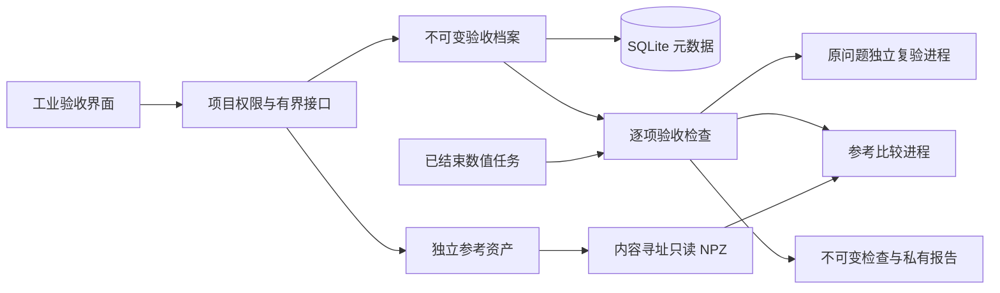

# v0.6 工业验收域与数据结构

系统仍采用模块化单体服务和独立数值工作进程。工业验收作为独立领域模块接入路由，复用项目权限、事务、配额和内容摘要，不把参考数据加入求解配置或工作规格。SQLite 仍是 schema 2，不改写旧任务、旧配置和旧检查点。

## 实体与一致性

| 实体 | 主键与载荷 | 绑定及约束 |
|---|---|---|
| `industrial_cases` | `ic_` UUID；`industrial/<dossier_sha256>.json` | 项目、矩阵字节摘要、任务、原目标、工程模型、用途、验收范围、物理与参考摘要；修订保留父版本。 |
| `industrial_reference_assets` | `ir_` UUID；`industrial/<sha256>.npz` | 项目、文件大小、完整 n 行、模式数、数据类型；独立来源和目标绑定由档案冻结，上传不等于参考可信。 |
| `industrial_checks` | `ick_` UUID；`industrial/<check_sha256>.json` | 档案摘要、逐项证据、创建时刻与聚合状态；历史结果不替代新检查。 |

原始矩阵、候选输出和参考制品各有独立摘要。候选任务编号或其已知产物摘要不能充当独立参考出处；重新打包候选输出仍需外部机构审查，摘要本身无法证明独立性。档案把 `matrix_eigenproblem` 与 `resonant_frequencies` 分开：矩阵范围不要求伪造几何，频率范围必须具备冻结工程映射与适用物理证据。

载荷以独占创建、只读保存；写入元数据和项目用量处于同一事务。重复相同档案复用原记录。项目管理员建档、修订、上传；分析员执行检查；读者查询和导出。业务归档后拒绝新写入。

## 大规模数据与资源

JSON 清单限 1 MiB，避免把大向量塞进页面。外置参考只接受两个明确的 NPY 成员，上传和展开各限 128 MiB；最多 200 万行、32 模式、800 万向量项。特征值仅 `float32/float64`，向量另支持 `complex64/complex128`；拒绝整数转浮点造成的静默舍入。主进程仅读有界 ZIP/NPY 头部、摘要和元数据，完整有限值检查及对齐在单个受监视子进程进行。

参考子进程限 2 GiB、30 秒、1 数值线程；内联小参考另限 512 MiB、10 秒。原问题复验沿用 2 GiB、30 秒门禁。每实例对参考计算及验收检查分别设非阻塞入口锁，超额请求返回 409；这不把服务宣称为多节点计算集群。预算内未完成为未认证，不能补填零误差。

普通本机数值进程和验收进程是资源隔离进程，不是文件系统沙箱。候选求解配置不携带参考或信任密钥；需要抵御同用户恶意程序时，须使用既有隔离容器入口并在独立评测端管理信任数据。

## 信任、检查与恢复

`PASS`、`FAIL`、`UNVERIFIED` 逐项保存；任何失败使整体失败，缺证据使整体未认证。无频率或性能请求明确为未要求，不增添相应结论。物理与参考回执使用可选配置机构认证，只认证该机构声明，不是官方认证或物理真值证明。密钥文件须在业务根外，路径和权限受检查；备份另显式排除配置的密钥文件。

备份恢复验证三个新增实体种类、载荷摘要、规范编码、模式维数、跨项目和任务绑定、修订链、检查聚合状态，重新绑定新根路径并重建配额。缺失载荷默认拒绝，显式降级时标 `MISSING`。恢复后要重新执行检查，历史通过保留为历史证据。

当前真实 589446 阶微波矩阵已经完整取得并通过厄密性检查。首次本机 JD 实验没有取得合格模式；模型物理审查和目标完整性仍不可凭数据来源推定通过。完整原矩阵和工作矩阵均不稠密化，小参考夹具测试不是工业性能证据。
